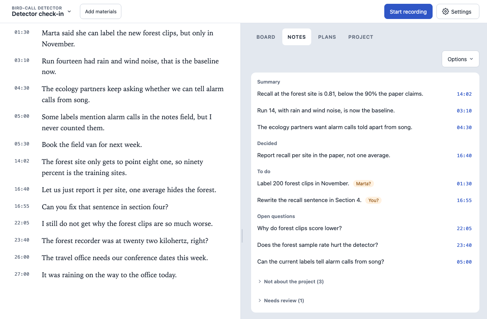
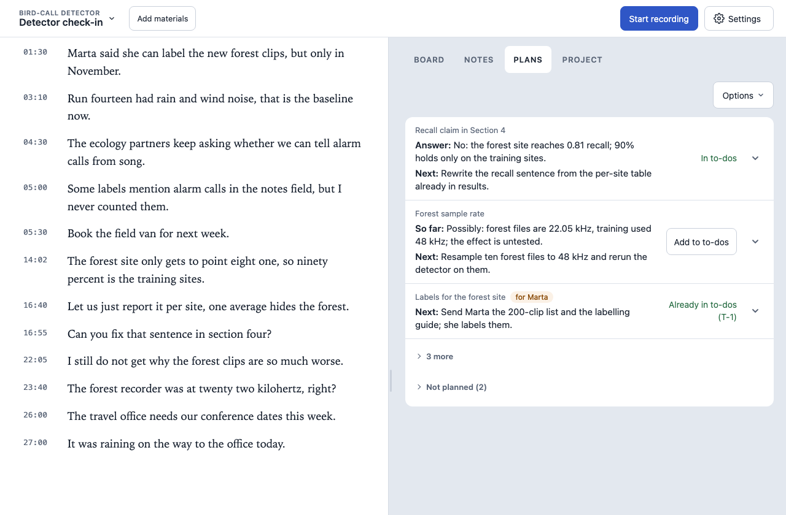

# HearAlong

[](https://github.com/Zihao-Qi/HearAlong/actions/workflows/ci.yml)

HearAlong is a Mac app for people who mostly listen in meetings and lectures. It transcribes on your Mac as people speak, explains any line you select, and afterwards turns the meeting into notes and next steps that point back to what was actually said.



*The transcript, with notes linked to the moment each point was said. Every example in this repository is fictional.*

## What it does

- **Live transcript, on the Mac.** It records the room microphone, a Chrome tab, or a meeting app such as Zoom or Teams. On a call, your microphone is labelled *Me* and the call *Them*; wear headphones so the call doesn't leak into your microphone. Grey preview text appears about 2 seconds after the words are spoken and settles into final text in place. English only for now.
- **Ask about any line.** Select a sentence to have it explained, answered from your project's files, looked up, or worked out as a small calculation, with the sources shown.
- **A board of questions and decisions** that fills in during the meeting (in On this Mac mode, once you stop).
- **Notes and plans afterwards.** Each point links to where it came from, and the quotes are checked against the source.
- **Project memory.** Decisions carry over to the next meeting of the same project, with history and undo.
- **A mini window** that stays on top of full-screen calls, with the latest lines and a Stop button.



## Install

You need macOS 26 or later, [Google Chrome](https://www.google.com/chrome/), [Homebrew](https://brew.sh/) and Apple's command line tools (`xcode-select --install`). Apple Silicon is recommended; Intel Macs work, with slower transcription.

```sh
curl -fsSL https://github.com/Zihao-Qi/HearAlong/releases/latest/download/install.sh | sh
```

The installer checks the release checksum, installs or updates Node.js and FFmpeg through Homebrew when needed, and never asks for an administrator password. HearAlong then opens in Chrome; in Setup, download the speech model (731 MB) or pick one already on your Mac. Run the same command again to upgrade.

The AI features are optional and set up separately: a local model through Ollama or LM Studio (the suggested one is about 4 GB), or a cloud provider you approve.

To uninstall, quit HearAlong and run `sh "$HOME/Library/Application Support/HearAlong/app/install.sh" --uninstall`. Your transcripts and notes stay in `~/Library/Application Support/HearAlong/data/` until you delete them. Audio is deleted one day after it's transcribed; you can keep it longer in Settings.

To run from source, see [app/README.md](app/README.md).

## Privacy

Audio and speech recognition never leave the Mac. For the AI features you choose one of three modes in Settings:

- **On this Mac:** models run locally through Ollama or LM Studio. Meeting text stays on the Mac.
- **Cloud:** you approve each provider before anything is sent. Only text is sent, never audio. Notes send the whole transcript; other features send the lines around your selection, project memory, and the attached files the model reads.
- **Off:** recording, transcription and playback work fully without any AI.

[What each feature sends](docs/architecture.md#what-each-feature-sends) lists exactly what goes to the provider. Your recordings, transcripts and notes are stored only on your Mac, and nothing from them is in this repository.

## How it's built

A few decisions that shaped it. The details, with links into the code, are in [the architecture notes](docs/architecture.md).

**Recording comes first.** Audio is written to disk in one-second frames before the browser is told it arrived, and saved audio survives a server restart. Everything involving a language model runs in separate processes, so a crash or hang there can't stop a recording. If the laptop sleeps, the transcript shows a marked gap rather than losing it silently.

**The live text doesn't flicker.** Each moment of audio is drawn from exactly one source (final, live or pending), so the switch from preview to final text is a single update and nothing jumps while you're selecting.

**AI output has to show its sources.** Notes and cards cite transcript lines; plans can also cite attached files, web pages and calculations. The server checks each quote against what the model was actually given. That proves the words are there, not that the conclusion is right, so everything the AI writes is shown as a draft. Plans are versioned, so an older run can't overwrite a newer one, and a plan is marked when the transcript it relied on changes later.

**AI tools only see what you attach.** When the model reads files, it can open only the meeting's attached materials and the project's memory, never the rest of your Mac. Files named like private keys or credentials are refused, even inside an attached folder. Calculations run in a macOS sandbox with no network, and they can't read or write your files.

Accuracy and latency on a public meeting corpus are in [Benchmarks](docs/benchmarks.md).

## Built with

TypeScript and Node.js, plain JavaScript in the browser, SQLite, Swift for the macOS helper, NVIDIA's Parakeet speech model through `transcribe-cpp`, and the [Pi](https://www.npmjs.com/package/@earendil-works/pi-coding-agent) agent for language models.

I designed HearAlong and made its product decisions; the code was written with AI coding agents under my direction.

## License

MIT, see [LICENSE](LICENSE). Bundled libraries keep their own licenses: see [app/public/vendor/README.md](app/public/vendor/README.md) and [THIRD-PARTY-LICENSES/](THIRD-PARTY-LICENSES/).
