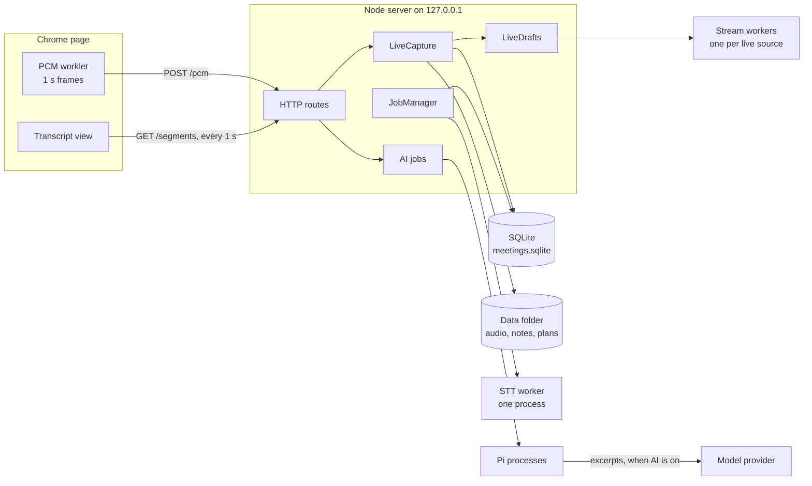
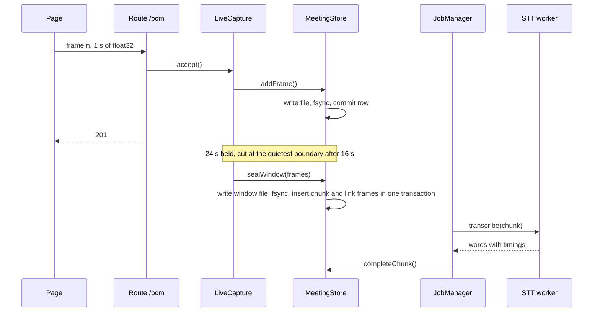
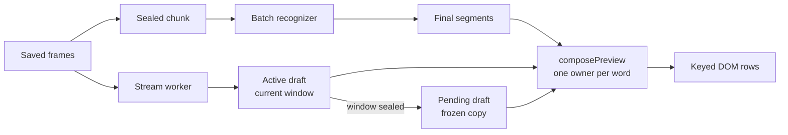
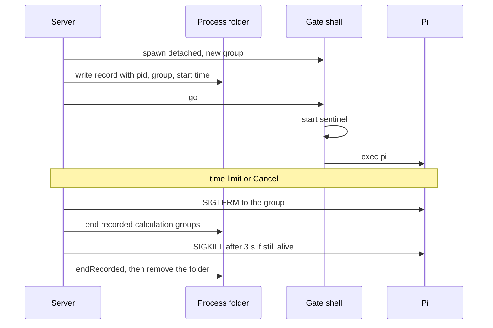
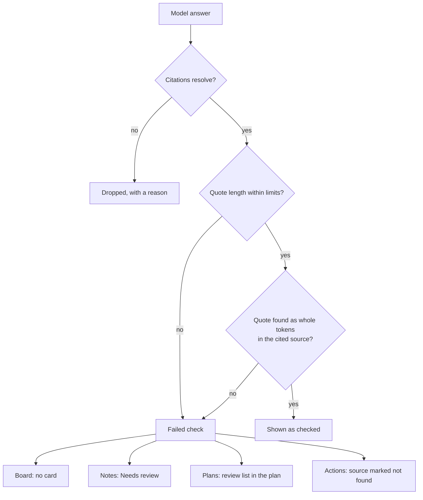

# HearAlong architecture

HearAlong is a local web app for macOS. A Node.js server (TypeScript, run with `--experimental-strip-types`) listens on `127.0.0.1` and serves a plain-JavaScript page in Chrome. The page sends audio to the server one second at a time. The server saves it, transcribes it with a local speech model in a separate process, and keeps its state in one SQLite database and a data folder. Language-model features run through the [Pi](https://www.npmjs.com/package/@earendil-works/pi-coding-agent) agent CLI, always as separate processes.

This page covers four parts: audio that is not lost, a live transcript that does not flicker, agent processes that cannot outlive their job, and quote checks on model output. Each claim links to the code that implements it.

The entry point is [`startServer`](../app/src/server.ts); a lock file ensures one server per data folder ([`lock`](../app/src/server.ts)).

## 1. Audio capture and durability

### In the browser

[`startRecording`](../app/public/app.js) opens one 16 kHz `AudioContext` for the recording. The microphone ("Me") always records; for an online meeting, [`pickMeetingTab`](../app/public/app.js) also takes a Chrome tab's audio ("Them") and refuses a window or a screen. [`addSource`](../app/public/app.js) gives each source its own mono `AudioWorkletNode`, so a stereo tab is mixed down, not cut to one channel.

The worklet, [`PcmCapture`](../app/public/pcm-worklet.js), fills a 1-second `Float32Array` (16,000 samples) and transfers it to the page. Each frame carries the wall-clock time of its first sample, taken from the audio clock by [`SampleCaptureClock`](../app/public/capture-clock.js), not from the time of upload.

Frames of one source are uploaded strictly in order through [`uploadWithRetry`](../app/public/upload-retry.js). Network errors and 5xx replies are retried with backoff from 0.5 s to 4 s, each attempt has a 10 s limit, and a frame gives up only after at least three failures and 30 seconds. A 4xx reply is not retried. If a frame gives up, or 30 frames are waiting, that source stops and the page says what was lost; the other source keeps recording.

### On the server

The route `POST /api/meetings/:id/pcm` in [`server.ts`](../app/src/server.ts) checks the headers (source id, sequence, 16 kHz), reads at most one second of float32 samples and rejects non-finite or out-of-range values. [`LiveCapture.accept`](../app/src/live.ts) then runs all work for that source on one promise chain, so saving, sealing and ending never interleave.

[`MeetingStore.addFrame`](../app/src/store.ts) decides durability:

- The frame must have the next sequence number and start where the previous one ended (within 1 ms). A repeat with the same bytes returns the saved frame, so a retry after a lost reply cannot duplicate audio; a different frame under the same number is refused.
- The bytes go to a new file opened with `wx`, which is then `fsync`ed. The directory is synced too, as a best effort ([`syncDirectory`](../app/src/store.ts)).
- The frame row and any capture-gap rows commit in one SQLite transaction, with `journal_mode=WAL` and `synchronous=FULL`.

Only then does the route answer `201`.

### Windows and transcription

HearAlong records 16 kHz mono float32 PCM and reads its saved samples directly for transcription, live drafts and playback; recording and transcribing recordings do not need FFmpeg. Only importing audio/video files needs FFmpeg/ffprobe, for duration probing and media decoding ([`audio.ts`](../app/src/audio.ts), [`listen-imports.ts`](../app/src/listen-imports.ts)). Missing FFmpeg does not block speech setup or recording readiness.

Saved frames are held until they are grouped into a transcription window. Once 24 seconds are held, [`LiveCapture.sealIfDue`](../app/src/live.ts) cuts at the quietest frame boundary between 16 and 24 seconds ([`chooseCut`](../app/src/live.ts)). A source that ends, or is silent on the network for 10 seconds, is sealed whole.

[`MeetingStore.sealWindow`](../app/src/store.ts) writes and syncs the window's audio, then inserts the chunk row and links the frames to it in one transaction. A crash leaves either held frames, which are sealed again, or a complete window. Frame files are deleted only after the commit; [`removeSealedFrameFiles`](../app/src/store.ts) finishes interrupted cleanup at startup, and only if the window file exists. Failed writes remove their unpublished files. Before starting jobs or accepting capture, startup also reconciles generated audio files with frame/chunk references and removes unreferenced files left by interrupted writes. A post-save sealing error leaves frames held for a later seal rather than revoking their acknowledgement.

[`JobManager`](../app/src/jobs.ts) transcribes queued chunks one at a time. A recognition failure is retried after 15 seconds and again after 60; after three attempts the chunk stays failed and shows as a gap the user can retry. A queue storage failure instead pauses the queue, reports its error to the page, and retries with backoff capped at 60 seconds. Completed recognition results stay in memory until their database write succeeds, without rerunning recognition; a server restart still recovers the persisted running chunk. [`LocalRecognizer`](../app/src/recognizer.ts) runs recognition in a forked [`stt-worker.ts`](../app/src/stt-worker.ts), so a crash in the native library ends that process, not the server. Each chunk has a 120-second limit. [`completeChunk`](../app/src/store.ts) publishes the text and its timed segments in one transaction.

### Gaps and sleep

[`detectFrameCaptureGaps`](../app/src/capture-gaps.ts) compares the capture time where one frame ended with the capture time of the next frame's first sample; more than 5 seconds apart is a gap. The worklet also reports gaps inside a frame. The page watches its timers and Chrome's `resume` event ([`CaptureSuspension`](../app/public/capture-clock.js)), and a gap that overlaps such a pause is labelled as sleep. Gaps are saved with the frame and shown in the transcript as a line such as "Not recorded for 8 minutes … the Mac was asleep" ([`captureGapText`](../app/public/capture-gaps.js)). They are never sent to a model.

### Server restarts

A recording continues across a server restart. The page keeps capturing and retrying while the server is down. Its session cookie remains valid: [`sessionToken`](../app/src/session-token.ts) saves a private token atomically in the data folder and reuses it across restarts. At startup the store re-queues chunks that were `running` (the [`MeetingStore`](../app/src/store.ts) constructor), and [`LiveCapture`](../app/src/live.ts) marks open recordings as `recovering`. The next actual frame reopens its source and continues at the next sequence number; an unrelated page heartbeat does not reopen a source. Failed Stop confirmations are retained and retried separately from the finished capture session ([`createRecordingEnds`](../app/public/recording-end.js)). A sweep every 2 seconds seals sources that went quiet; a recording whose page has not returned within 60 seconds is marked abandoned. A normal shutdown seals everything held before closing the store ([`LiveCapture.close`](../app/src/live.ts)).

### Audio retention

[`AudioRetention`](../app/src/audio-retention.ts) deletes raw audio a set time after a meeting is fully transcribed: one day by default, or a week, a month, or never. The removal is first committed in the database (the meeting is marked and its file paths are cleared), then the files are deleted. Only `.f32` files of that recording inside `data/audio/<meeting id>` are removed, checked with `realpath`; database paths are never followed, so imported files elsewhere are never touched. Transcripts and notes are kept.

### The guarantee, precisely

**Once the server has answered `201` to a frame, that second of audio has been handed to the disk (file `fsync`ed, row committed with `synchronous=FULL`). It will be transcribed, once a speech model is available, or shown as a failed gap, even if the server is killed right after.**

It does not cover:

- audio still in the page: up to a second in the worklet, plus frames queued or retrying (at most 30). If the tab or Chrome closes, or a source gives up, that audio is lost, and the page says so.
- the last part of a second when a source ends, if the worklet does not hand it over within 1.5 seconds.
- time when nothing was captured, such as a sleeping Mac. It is shown as a gap, not recovered.
- sudden power loss, fully. The audio file is flushed through the drive's write cache (Node's `fsync` uses `F_FULLFSYNC` on macOS), but SQLite's commit uses a plain `fsync` because its `fullfsync` pragma is off by default, so the frame's row could be lost with the drive cache. The directory sync is best effort.
- disk failure: there is no second copy.
- audio removed by the retention setting.

## 2. Final, live and pending text

The transcript shows three kinds of text:

- **Final**: segments from the batch recognizer, stored in SQLite.
- **Live (active)**: the current window's draft from a streaming recognizer.
- **Pending**: a draft frozen when its window was sealed, shown until that window's final text arrives.

[`LiveDrafts`](../app/src/drafts.ts) runs one [`stt-stream-worker.ts`](../app/src/stt-stream-worker.ts) process per live source (at most two) and one stream per window, fed with every new frame that `LiveCapture.accept` saves. A worker more than 4 seconds behind stops being fed for that window; one that hangs for 10 seconds is killed. Drafts are never stored or sent to a model, and nothing in this path can delay saving audio or final text. At a seal, [`LiveDrafts.seal`](../app/src/drafts.ts) keeps the last displayed draft as the new chunk's pending block, and the next stream starts from the frames after the cut ([`restartDraft`](../app/src/live.ts)).

### One owner per moment

Each stretch of audio is drawn from exactly one layer. Ownership is decided per source and per word, by the time of the word's midpoint (word times come from the stream's token timestamps, [`timedWords`](../app/public/preview-composition.js)):

1. **Final wins.** In the same response that carries the final segments, the server removes draft and pending words inside any finished chunk: completed (with its lines shown, or empty), failed or cancelled ([`ownsDisplayInterval`](../app/src/drafts.ts), [`LiveDrafts.pending`](../app/src/drafts.ts)). A final line and the draft words it replaces never arrive in different polls.
2. **Active beats pending.** Pending words that the new stream has committed are retired ([`retireCovered`](../app/src/drafts.ts)).
3. **Newer pending beats older pending** ([`composePreview`](../app/public/preview-composition.js)).

### No flicker

[`transcriptRows`](../app/public/transcript-view.js) gives every row a stable key. The pending text before a cut and the first final paragraph of the same chunk share the key `chunk:<chunk id>`, so when the final text arrives the same DOM node is refilled in one synchronous step; nothing is removed and added again. [`render`](../app/public/transcript-view.js) rewrites a node only when its content signature changes.

### Selection-safe scrolling

[`createTranscriptView`](../app/public/transcript-view.js) keeps text still while the reader works with it:

- While a pointer button is down, rendering waits.
- Rows that intersect the selection are frozen; new text goes around them ([`aroundSelection`](../app/public/transcript-view.js)), never inside the selected range.
- After each render, the scroll position is corrected so the selected text, or the line under the pointer, stays at the same height. Extra bottom padding stops the browser from clamping the scroll when a preview gets shorter.
- The view follows new text only while the reader is at the bottom.

### The lighter poll

The page polls `GET /api/meetings/:id/segments` once a second. Drafts, pending text and status are sent whole; the list of final segments is sent as a delta. The page returns the tag it received last ([`createSegmentsPoll`](../app/public/segments-poll.js)), and [`SegmentsTag.delta`](../app/src/segments-tag.ts), which hashes the serialized list as a running prefix, answers with:

- only the new segments, if the page's list is still a prefix of the current one;
- otherwise everything after a checkpoint 32 segments from the end, if that is unchanged (glossary corrections edit recent lines);
- otherwise the full list.

Tags carry an HMAC and a per-process nonce, so a restarted server or a malformed tag gets the full list. The page also falls back to the full list after any inconsistent reply.

## 3. Agent process isolation

All language-model work goes through Pi, which always runs as a child process; the server process loads neither Pi nor the speech library. A crash, hang or runaway tool in Pi cannot stop a recording, which runs entirely in the server and the STT workers.

There are two lanes:

- **Quick lane**: a warm `pi --mode rpc` process ([`PiRpc`](../app/src/pi-rpc.ts)) with tools off, one request at a time and at most 20 queued. The session is reset after every request, so prompts never see each other. A timeout kills and restarts the process, so a late answer cannot reach the next caller. [`ModelRpc`](../app/src/pi-rpc.ts) picks the model when a request is admitted. The server runs two: glossary correction (30-second limit) and Board scans (90 seconds).
- **Heavy tasks**: one `pi --mode json` process per task ([`runPiTask`](../app/src/pi-task.ts)), with a tool allowlist, a saved session log and a time limit: 10 minutes for notes, actions and glossary builds, 5 minutes for a whole plan pass, 20 for Explore further ([`EXPLORATION_LIMITS`](../app/src/explorations.ts)). A run counts only if it ends cleanly ([`checkCompleted`](../app/src/pi-task.ts)).

### Process groups

Actions and plans can run tools, including JavaScript calculations, so `runPiTask` starts them through [`spawnGated`](../app/pi-extensions/process-groups.ts):

1. A detached `/bin/sh` starts as the leader of a new process group and waits.
2. The server writes a record to `data/processes/<job>/`: pid, group id and the leader's start time from `ps`.
3. The server says "go"; the shell starts a small sentinel whose command line names the job's folder, then replaces itself with Pi.

The `calculate` tool records each script's own group in the same folder.

When Pi exits, [`endRecorded`](../app/pi-extensions/process-groups.ts) ends whatever is left in every recorded group and removes the folder only once that is confirmed; otherwise the records stay for the next start. Pi's own group is signalled directly only while Pi is still the server's live child, so its id cannot have been reused. Every group found through a record is first checked by [`verdict`](../app/pi-extensions/process-groups.ts): the leader's start time must match, or, if the leader is gone, the sentinel must still be in the group. A group that cannot be verified is left alone and logged, so a reused pid is never killed.

Notes, memory updates and glossary builds use no tools or read-only file tools and run as ordinary child processes, stopped with `SIGTERM` and then `SIGKILL` after 3 seconds.

Calculations cannot start child processes or workers. Timeout and cancellation kill the fresh Node process group, whose record also supports cleanup if Pi dies.

### Crash recovery

At server start, before the database is opened, [`recoverExplorations`](../app/src/explorations.ts) ends the groups of plan runs that were running and marks those runs interrupted, and [`endLeftoverProcesses`](../app/pi-extensions/process-groups.ts) ends everything else recorded under `data/processes`. Unfinished actions become `interrupted` and never restart by themselves ([`ActionJobs.load`](../app/src/actions.ts)).

### Plan pass: parallel copies

[`runPlanPass`](../app/src/plans/pass.ts) reads once, then writes in parallel. Stage 1 is one Pi run that reads the inputs, uses tools and returns an outline of at most 8 plans. For each plan, the stage-1 session file is copied and continued in its own Pi process, with the same model, tools and environment so that the shared prefix can come from the provider's prompt cache. Each copy has its own process folder. A rate limit or timeout in any copy stops all of them; another failure in one copy becomes a warning. Plan runs are scheduled by [`Explorations`](../app/src/explorations.ts): one at a time across the app, never during a recording or replay, and after the meeting's notes, memory update and actions.

### What each feature sends

AI has three saved modes: **local**, **cloud** and **off** ([`AiSetup`](../app/src/setup/ai.ts), [`mode settings and migration`](../app/src/setup/ai-settings.ts)). Main and Quick choices are saved separately per mode. Audio and speech recognition never leave the Mac.

New installs use local AI if discovery finds a model server, otherwise Off. An install that finished setup before this change and still lists non-local models retains Cloud with timestamped legacy provider consent and a one-time notice offering Change… or Keep cloud. Cloud saves require consent to the selected provider set; server-side model admission checks consent as well, including environment overrides. Changing the consented provider set cancels all cloud work (not just newly disallowed providers). Mode/generation guards recheck after asynchronous dependencies and immediately before metadata spawns; explicit dialog previews remain allowed. `MEETING_CLOUD=0` forces Off for the current start without replacing a saved mode.

In **local** mode the table below describes data sent only over loopback to Ollama or LM Studio, not to an external provider. The bundled [`local-models.ts`](../app/pi-extensions/local-models.ts) registers native Pi providers with bounded, non-persisted discovery and Pi's OpenAI-compatible API. Discovery, metadata, warm-up and both streaming methods use a dedicated direct dispatcher; each request validates loopback URLs and refuses redirects before any forwarding. Local children lose all environment proxy variables, including bypass variables. [`piLaunch`](../app/src/pi-command.ts) is the common argv/env boundary for listing, tasks and RPC: local runs set `PI_OFFLINE=1`, disable discovered extensions and skills, explicitly load only bundled extensions, and omit provider credentials from the environment. An app-owned `.pi-local` agent directory under each scratch working directory keeps user `models.json` endpoint overrides and credential commands out. Local runs also cancel automatic compaction: overlong input must fail, not be silently summarized. Only `ollama/*` and `lmstudio/*` model IDs may run. Pi makes no automatic internet requests in this mode; web tools are unavailable. Board and correction schedulers pause while any recording is in progress and catch up afterwards. Typed recording deferral/interruption is not a scan failure: it neither consumes retry/skip budget nor advances coverage/backoff. Context admission uses measured loaded context, never trained maxima: an unloaded selected model gets a fixed one-word, one-token OpenAI-compatible request before measurement, with no meeting text. Catalog metadata has a five-second per-process cache; inference re-measures before sending full messages. The padded estimate is 3 characters/token plus 25%, 512 fixed tokens and output allowance. Unknown context refuses with configuration guidance. See [context metadata, assumptions and fake-only evidence](local-ai-context.md).

In **Cloud**, the table describes data sent to the consented providers. Web lookups additionally contact search/page services, but are available only when Pi's web-search package is already set up in Pi. HearAlong does not install it; otherwise web-only actions are hidden and Plans/Explore omit web tools. Pi may refresh its model catalog and provider credentials; user-enabled extensions may contact their own services. Pi telemetry and version checks are disabled in every mode. **Off** admits no Pi jobs or model calls; model metadata discovery is limited to initialization and explicit mode selection/rechecks. Recording, transcription, listening and exports remain available. Speech/local-model downloads are separate setup operations; calculations need no additional installation or downloads.

In both AI modes, [`read-scope.ts`](../app/pi-extensions/read-scope.ts) allows only known tool names/arguments and real paths under the task's current attached meeting/project materials, supplied memory snapshot, or scratch cwd. A linked repo is not implicitly a material. Action follow-ups/retries intersect captured material roots with current attachments; snapshots can include the project brief/history and other meetings' saved notes. Material contents are read-only: edit/write is scratch-only. Missing roots or an absent explicit tool list disable tools. Exclusions apply below roots, including hidden/credential components, Pi sign-ins, Keychains and other HearAlong data. Native realpaths and filesystem identities handle aliases; file tools refuse regular files with multiple hard links under every root. Recursive grep/find is refused if metadata traversal finds excluded/sensitive descendants, symlinks, an unreadable tree or over 20,000 entries: use a smaller clean subtree or an explicit permitted file. This preserves the bundled search implementations rather than wrapping their child processes. Search helpers may consult outside ignore files (`.gitignore` and global Git ignores) to decide what to skip; their contents are not shown to the AI. Web URL arguments must be HTTP(S) with no direct localhost, loopback, unspecified, private or link-local destination. WHATWG normalization handles alternate integer/hex/octal/short IPv4 spellings; IPv4-mapped/compatible IPv6 is checked too. `fetch_content` requires at least one URL. A public-looking hostname can still resolve to a private address (DNS rebinding); the hook does not resolve DNS. `fetch_content` clones are not readable by file tools unless attached.

Scoped tasks use the bundled Pi executable, matching the path resolver/schema used by the hook; credentials and user extension configuration still come from the existing agent directory. Every task/RPC/listing CLI launch uses `--no-approve`, overriding inherited project trust and preventing planted `.pi` resources from loading. Calculation code cannot write cwd `.pi`, `.agents`, `AGENTS.md` or `CLAUDE.md`, create links, or run concurrently with other tool calls. [`tool-sandbox.ts`](../app/pi-extensions/tool-sandbox.ts) narrows contents/xattrs and executable access, blocks networking including Unix sockets, signals to other processes, preference access, AppleEvents, pasteboard/Spotlight services, Keychains, Pi sign-ins and other app data. The legacy task profile allows scratch writes except protected project resources; the calculation mode instead denies all file writes except `/dev/null`, and grants no reads of scratch, materials, memory snapshots or home contents (apart from explicitly selected installed runtime files). Snapshot sensitive-name denies are repeated after their read allow. Roots with a quote, backslash or newline in their real path are refused before building the profile, with a rename/detach message. The legacy task profile's system read roots exclude `/usr/local` and broad `/Library` data, but include extra read-only locations `/opt/homebrew/Cellar`, `/private/etc` and `/dev`. Calculation mode uses only startup system locations (root directory itself, system libraries, Apple runtime libraries, dyld/timezone data, localtime and null/random devices), Node's executable/loaded shared libraries, the trusted runner and mathjs dependency closure; it has no broad Cellar, `/private/etc` or `/dev` grant. The sandbox still allows other macOS system services by default apart from the named restrictions on clipboard, Spotlight, preferences, AppleEvents and Security.

[`calculate.ts`](../app/pi-extensions/calculate.ts) runs JavaScript on HearAlong's bundled Node with bundled mathjs (global `math`); nothing is installed or downloaded for calculations. Each snippet runs in a fresh child with `--permission --no-addons --disable-sigusr1 --max-old-space-size=256`, without any child-process, worker, addon or WASI allowance. Inspector APIs are denied by the permission model. `--allow-fs-read` grants only the trusted runner and mathjs dependency closure, never the task scratch or materials; no file-write permission is granted. Code arrives on stdin. Snippets execute in the runner's realm with `math` and `console` arguments, so object literals work with mathjs's options/config APIs. No lexical `require` or `module` is provided; Node globals such as `process` and `globalThis` remain reachable, including indirect CommonJS access through `process.mainModule`. Node permissions and Seatbelt, not JavaScript scope, enforce the boundary. Node permissions restrict ordinary filesystem APIs and deny starting programs/workers, addons, WASI, inspector and `process.binding`. Node 22 permissions do not control networking or signals to other processes: Seatbelt is the network and cross-process signal boundary. The calculation-specific Seatbelt profile also blocks task-file reads and all writes except `/dev/null` through native APIs such as `node:sqlite`, which do not enforce Node's filesystem permissions. The child environment allowlist contains only `LANG`, `LC_*` and `TZ`; the trusted runner removes gate/macOS-added variables before evaluating code. Materials are read through Pi's scoped file tools. Seatbelt denies network (including Unix sockets), links and unrelated executables. File metadata outside the data folder can remain visible; these layers are not an OS container. Numbers are IEEE doubles unless the snippet uses mathjs BigNumber or fractions. Only printed output is returned, capped at 20 KB each for stdout/stderr; stderr is labelled and returned on success too. Existing per-run and task run-count limits remain. V8 old space is limited to 256 MB, enough for mathjs and small matrix work; external Buffer/ArrayBuffer storage is not covered by that heap limit. A trusted parent-side `/usr/bin/top -l 1 -F -R -stats pid,mem -pid <pid>` watchdog samples macOS physical footprint (the Activity Monitor Memory metric, including compressed pages) against 512 MB, waiting 100 ms between completed samples. `top` is a stock macOS utility, not a Command Line Tools dependency. Each probe has a 5-second timeout for slow hosts; probe runtime adds to the sampling interval. An initially omitted PID during the gate/Node exec transition is retried for at most 5 seconds; once a valid sample has been seen, an omitted or malformed sample fails closed immediately. The watchdog kills the recorded group on excess (or inability to monitor), reporting a clear memory error. Sampling can overshoot and is not a hard allocation quota or an OS resource limit.

The runner needs no native supervisor or compile step: generated code cannot start programs. Offline tests exercise output, limits, cancellation, filesystem/native-API denial and ephemeral loopback socket denial. New saved evidence uses `tool: 'calc'` with `language: 'javascript'`; legacy `tool: 'python'` evidence remains readable and renders Python code unchanged.

Pi itself and trusted user extensions remain outside this OS boundary. A later extension's `tool_call` handler can rewrite approved arguments: only enable extensions you trust. In Cloud mode, permitted file-tool results and JavaScript output can be sent to the selected provider.

| Feature | Lane | Sent to the model provider |
|---|---|---|
| Correction ([`correctionPrompt`](../app/src/correction.ts)) | quick | The glossary and up to 24 unchecked lines with 2 lines of context, at most once a minute per meeting; lines of only filler words are not sent. |
| Glossary build ([`glossaryPrompt`](../app/src/correction.ts)) | heavy, read-only file tools | Attached materials, as Pi reads them, including PDF text. |
| Board scan ([`scanInput`](../app/src/board.ts)) | quick | Title, glossary terms, up to 30 open cards, open project-memory items (about 12,000 characters at most), and up to 4 minutes of unscanned final speech with 90 s of context. |
| Notes ([`notesInput`](../app/src/notes.ts)) | heavy, no tools, three parallel calls | The whole final transcript (corrected and as heard), title and glossary terms. |
| Memory ([`proposalInput`](../app/src/proposals.ts), [`MemoryFiles`](../app/src/memory-files.ts)) | heavy, no tools | Project memory items; the meeting's decisions, actions and open questions with their cited lines; lines added to the memory files by people or agents; subjects and paths of up to 50 recent commits, to guess a change's source. |
| Explain and other actions ([`actionInput`](../app/src/actions.ts)) | heavy, per-action tools | The selection, the transcript from 2 minutes before to 30 seconds after it, title, glossary terms; files Pi reads from the materials and a read-only memory snapshot. Compute runs JavaScript on the Mac and sends its output. |
| Plans ([`buildPlanInput`](../app/src/plans/input.ts)) | heavy, file, web and calculation tools | The notes, the transcript lines they cite, project memory and the list of materials (about 200 KB at most); files Pi reads. |
| Web lookups (Cloud only) | tools in actions and plans | When Pi's web-search package is already set up, queries and addresses go to its search/page services; page text then goes to the model. HearAlong does not install the package. |

## 4. Quote checking

Each AI feature that makes claims about a meeting must cite its sources and copy a short quote from each. Code, not the model, checks the quote against the text the model was given or actually read. The checks prove that the quoted words exist in that source. **They do not prove that the claim is true, or that the quote supports it.** That is why notes, cards and plans are presented as drafts.

### Matching

All checks share [`tokens`](../app/src/notes.ts) and [`contains`](../app/src/notes.ts). Text is normalized (NFKC, lower case, one form for quote marks and dashes) and sentence punctuation is ignored. Numbers stay whole ("7.25"); hyphens, signs, comparisons and brackets are tokens of their own, so "n-1" never matches "n 1". A match must be whole tokens in order: "sort crate labels" is not found in "sort crate labelling". A quote may match the corrected line or the line as first heard, and the result records which.

### Per feature

- **Board** ([`validateItems`](../app/src/board.ts)). An item cites 1 to 8 scanned lines, at least one new, with a quote of 3 to 25 words. A quote may span cited lines only if they are consecutive in the transcript (and on one channel when Me and Them are labelled), so joining two lines can never skip a "not" said between them. The shortest run of lines containing the quote must include a new line. **On failure the item is dropped and no card is made**; the reason goes to the scan log.
- **Notes** ([`validateNotes`](../app/src/notes.ts)). Each item supplies 1–3 separate `quotes` (legacy `quote` is accepted as one; `quotes` wins when both are present). Each 5 to 25 word quote is checked independently against the same model cites, and every quote must pass. A quote first matches one cited line, then 2–3 consecutive cited lines on the same source (`spans_lines`). Only if those cited tiers fail, deterministic search locates minimal matching runs across the whole snapshot (`located`): accept a unique location, or exactly one location overlapping the model's valid cites; ambiguous matches go to Needs review only when a valid model citation remains, otherwise the item is dropped as `no valid citation`. Each line's tokens and joined token string are cached once per validation. Every passed quote's own lines come first in quote order, de-duplicated, followed by other valid model cites up to 8 total; quote lines are never dropped for the cap, even if they alone exceed 8 or the model gave no valid citation. Corrected and originally heard text are never mixed within a match. An ellipsis (`…` or `...`) is accepted only with ordered pieces of at least 10 characters and 2 words each, totalling 5–25 words, with at most 25 skipped words per gap and no hidden negation or condition (`elided`). Gap safety uses punctuation-aware word boundaries, including within tokens such as `not,really` or `can't,actually`, without changing quote-matching normalization. Whole sentences joined without an ellipsis use the same safe-gap check within a single minimal run (`joined`), storing inserted ellipses where words were skipped. No fuzzy matching is accepted. An owner counts only if a sentence in the model's own valid cited lines assigns the work to that name with no negation or condition ([`assignsTo`](../app/src/notes.ts)); otherwise it is shown as unconfirmed. The three notes parts are written blind. After all quotes are checked, each non-project range contradicted by at least 3 distinct verified project items is ignored: only the passed quotes' own line IDs count as evidence, all of an item's quotes must pass, and normalized item text de-duplicates the count across project sections. Other matters never count. Each ignored range has its own drop reason with the count; numeric `otherTalkIgnored` on the job's `notesParts` entry in `job-durations.json` records the number ignored. Remaining non-project ranges are checked against final cites; the start time remains the earliest cited line. **On failure the item goes to Needs review** with the reason, or is dropped if it has neither valid cites nor a locatable quote. Multiple-quote failures name the failing quote (for example `quote 2 of 3 not found in the cited lines`); more than 3 quotes needs review. Each stored quote keeps its text, reading, tier and own passed line IDs (or no lines on failure). Compatibility fields keep the texts joined with ` … ` and the least direct tier in the order direct, `spans_lines`, `elided`, `joined`, `located`; metrics count one outcome per item, including `too_many_quotes`. Markdown exports each quote on its own blockquote line; the notes screen and downstream proposals keep their existing behavior. Old single-quote records gain a one-quote list on load without rewriting disk. Old `passed_after_nearby_line` records remain readable, but new results never use that tier.
- **Plans** ([`checkSource`](../app/src/plans/validate.ts) in [`checkPlans`](../app/src/plans/validate.ts)). Each finding has a 5 to 25 word quote from a transcript line in the input; from a file, starting within 5 lines of the cited line in what the run's `read` and `grep` calls returned; or from a page fetched in this run. Tool results are saved as they stream in ([`EvidenceRecorder`](../app/src/plans/evidence.ts)), so the check uses the text Pi saw, not the file as it is later. A quick check must name a `calculate` call that finished without error. **On failure the finding is listed in the plan's review section; the plan is still shown.** Only structural faults drop a plan, such as having neither an answer nor a next step. A run is published by compare-and-swap on the version it started from ([`PlanVersions.publish`](../app/src/plans/versions.ts)), so a stale run never overwrites a newer version.
- **Actions** ([`checkAnswer`](../app/src/actions.ts)). A file quote must lie within the cited line range, ±3 lines, of a file inside an attached root ([`checkFileSource`](../app/src/actions.ts)); a web quote must be in a page this run's tools returned ([`checkWebSource`](../app/src/actions.ts)); a transcript quote must be in the transcript context. Each source is marked, for example "quote found", "quote not found" or "seen in search only".

### PDFs

Pi's file tools would see a PDF's compressed bytes, so [`PdfText`](../app/src/pdf-text.ts) extracts each PDF once with macOS PDFKit, adding page markers, and gives each task its own copy of the text. [`pdfQuoteSpan`](../app/src/pdf-text.ts) matches quotes against it:

- A word hyphenated across a line break, or with a soft hyphen, matches both its joined and its hyphenated form, and [`quoteReadings`](../app/src/pdf-text.ts) does the same for a quote copied with the break.
- A hyphen with no space after it ("x-y") and a minus sign never count as a word break.
- Lines the app wrote (header, page markers) are never evidence, and a quote may cross a page break. The page number comes from the markers ([`pageAt`](../app/src/pdf-text.ts)).

## Testing

`npm test` covers 978 tests in 105 files under [`app/test`](../app/test), including one opt-in isolation probe skipped by default. They use real SQLite databases in temporary folders, with scripted stand-ins for the speech model and Pi. [`check-isolation.ts`](../app/scripts/check-isolation.ts) loads first: it sets a temporary home folder, replaces Pi with a stub that refuses model calls, and blocks any `fetch` not addressed to `127.0.0.1`.

Browser checks drive the real page in a disposable headless Chromium with fictional audio and data, for example [`capture-resilience-check.ts`](../app/scripts/capture-resilience-check.ts), [`m9a-page-check.ts`](../app/scripts/m9a-page-check.ts) (live and pending text, selection) and [`plans-check.ts`](../app/scripts/plans-check.ts). [`run-checks.sh`](../app/scripts/run-checks.sh) runs everything before a merge: 19 suites (unit tests, type check and 17 browser checks), at most two at a time under `nice -n 19`, each with its own home and temporary folder and npm offline. It fails if a test browser is left running ([`run-checks.ts`](../app/scripts/run-checks.ts)). The public-repository guard is tested separately in [`public-guard.test.cjs`](../app/scripts/public-guard.test.cjs).
